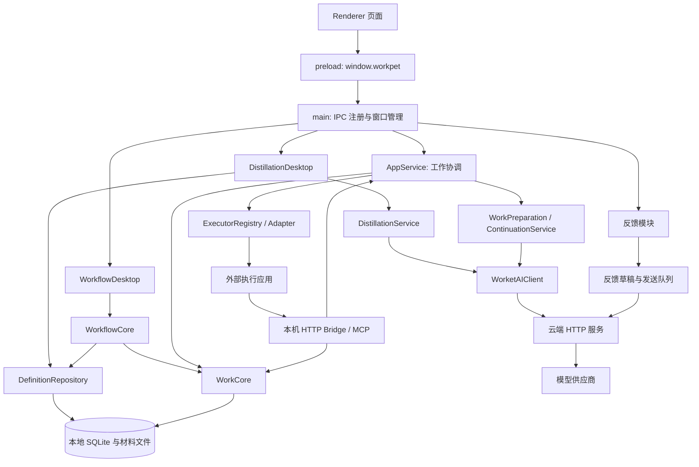

# Worket 架构现状地图

核对日期：2026-10-23。面向需要理解系统的人；以当前仓库源码为依据，不代表线上后台或已安装应用的版本核验。本轮只建立现状参考，不提出已批准的重构。

阅读顺序：本页 → [接口手册](interfaces.md) → [字段字典](fields.md)。查精确类型、所有 IPC 通道及 action 时使用[代码索引](code-index.md)。领域用语仍以 [CONTEXT.md](../../CONTEXT.md) 为准；历史决策与验收见[架构记录](../architecture.md)。

## 1. 系统在管理什么

Worket 将“工作本身”与“执行它的聊天/应用”分开：工作有自己的身份、要求、记录和交付；更换执行者仍可继续同一次工作。用户可以从记录沉淀可复用定义，也可以把多个定义连接成流程。

| 业务对象 | 作用 | 与其他对象的关系 | 代码入口 |
| --- | --- | --- | --- |
| 工作定义 | 一类工作的固定约定 | 一个系列有多个确认版本；实例固定引用一个版本 | [Definition](../../src/definitions/repository.ts)、[DefinitionContent](../../src/contracts/definition.ts) |
| 一次工作 | 某次真实开展的工作 | 有自己的记录；可经历多个执行片段和来源绑定 | [WorkInstance / WorkRecord](../../src/core/types.ts) |
| 执行片段 | 谁在什么环境承担这项工作 | 关联一次工作；交接可新增片段 | [ExecutionEpisode](../../src/core/types.ts) |
| 来源绑定 | 这项工作正在记录哪个外部会话 | 关联工作和执行片段；外部会话 ID 不充当工作 ID | [CaptureBinding](../../src/core/types.ts) |
| 来源事件 | 已观察到的输入、回复、工具结果等 | 原始档案保留观察历史；当前有效内容另外计算 | [SourceEvent](../../src/core/types.ts)、[source-revisions](../../src/core/source-revisions.ts) |
| 工作包 / 交接包 | 给执行者的本次有效约定和上下文 | 从工作、固定定义、材料及接续快照装配；交接包持久保存 | [WorkPackage](../../src/definitions/work-package.ts)、[HandoffPackage](../../src/core/types.ts) |
| 流程定义 | 多个固定工作定义的连接方式 | 节点引用固定 Contract 版本，输入绑定声明依赖 | [WorkflowDefinition](../../src/workflows/types.ts) |
| 一次流程运行 | 一整套流程的一次开展 | 每个节点可有多代 NodeRun，每代准备后关联独立 workId | [WorkflowRun / NodeRun](../../src/workflows/types.ts) |

**容易混淆的名称：**核心层 `WorkDefinition` 只有 id/key/name/version 等简要信息；沉淀模块 `Definition` 包含完整 content、来源、材料及确认信息。流程节点中的 `contractId` 指向后者的固定版本 id。它们共享 `work_definitions` 表，不是两套互不相关的工作身份。

## 2. 模块怎样连接

图中箭头表示主要调用路径，不是穷尽的 import 图。数据库事务与文件复制的边界不同，目录隔离也不等于给外部执行者建立了 OS 沙箱。

| 模块 | 负责的事 | 主要接口/依赖 |
| --- | --- | --- |
| [main](../../src/main.ts) / [preload](../../src/preload.cjs) | 创建窗口、服务、桥接；注册 IPC 并连接业务入口 | UI 通过 `window.workpet` 调用；不能直接读写 SQLite |
| [AppService](../../src/app/app-service.ts) | 发现/导入来源、记录同步、交接、应用状态投影 | WorkCore、执行者注册表、自动准备、文件跟踪 |
| [WorkCore](../../src/core/work-core.ts) | 工作身份、记录、事件、执行片段、绑定、生命周期 | `WorkCore` 接口；同一 SQLite 上提供 definitions/workflows |
| [DefinitionRepository](../../src/definitions/repository.ts) | 草稿审阅、不可变定义版本、实例输入、验收、命令去重 | content 校验、固定材料与实例文件、review_events |
| [DistillationService](../../src/distillation/service.ts) | 固定来源快照、提交/轮询提取、验证结果并产生候选 | 本地 Snapshot/Job、AIClient、来源与证据协议 |
| [WorkflowCore](../../src/workflows/core.ts) | 固定流程版本、运行、依赖、输入采用、代次与状态迁移 | DefinitionRepository、WorkCore、outputs/validation |
| [ContinuationService](../../src/handoff/continuation.ts) / [WorkPreparation](../../src/handoff/work-preparation.ts) | 基于当前来源、状态和材料整理本次接续信息，检查是否过期 | basis 摘要、托管 AIClient、工作包投影 |
| [ExecutorAdapter](../../src/executors/types.ts) | 统一应用差异：发现会话、读取/规范化历史、传递启动内容 | `ConversationSource`、`DeliveryRequest/Receipt`；应用支持能力不同 |
| [本机 Bridge](../../src/bridge/http-bridge.ts) | 接收 MCP、hook、选定内容与网页交付回执 | 回环地址、每次启动的令牌；MCP 交给统一处理器 |
| [AIClient](../../src/ai-service/client.ts) / [connection](../../src/ai-service/connection.ts) | 服务连接、凭据、能力检查、作业与确认回执 | `/v1/*` HTTP 协议 |
| [云端服务](../../server/managed.mjs) | 匿名身份、模型调用、额度、请求元数据、改进样本、反馈与管理 | 多个 SQLite 文件；模型工作结果短期在内存保存 |

## 3. 三条完整业务链

### 从聊天记录到可复用约定，再开展新工作

1. 页面调用 `createWorkFromConversation({executorId, threadId})`；AppService 读取并规范化外部会话，创建/同步工作、执行片段和来源事件，返回 `DashboardView`。
2. `distillation('prepare', {workIds, includedFileIds, ...})` 固定本次提取范围，生成本地 `Snapshot`。附件正文只按显式选择纳入。
3. `distillation('start', ...)` 校验范围、服务身份和能力后提交 `ExtractionRequest`，保存本地 Job，通过远端 requestId 轮询。
4. 响应校验通过后产生 `Draft`。用户经 `update` 解决内容/来源/问题，再 `publish` 保存不可变 `Definition`；模型结果本身不等于用户确认。
5. `distillation('create', {definitionId, inputs, referenceExampleIds, commandId})` 创建新 workId，固定本次输入；`dispatch` 调用 AppService 交付给选定执行者。

源码：[AppService](../../src/app/app-service.ts)、[Desktop 分发](../../src/distillation/desktop.ts)、[Service](../../src/distillation/service.ts)、[Repository](../../src/definitions/repository.ts)。

### 同一工作交给另一执行者

`handoff(workId, executorId)` → 同步当前记录并准备接续 → `createHandoffPackage` / `buildWorkPackage` → `buildWorkBootstrap` 装配启动文本 → Adapter.deliver → 外部应用 → MCP `get_work_context(work_id, delivery_id)`。

交接保持 workId；新的执行片段、来源绑定和 deliveryId 记录这次交付。打开应用、准备草稿、绑定真实会话、读取本次工作包，是不同证据。MCP 带正确 delivery_id 成功读取后才写本次读取回执。

源码：[handoff](../../src/app/app-service.ts)、[bootstrap](../../src/executors/work-bootstrap.ts)、[MCP](../../src/bridge/mcp-handler.ts)、[PackageReceipts](../../src/core/package-receipts.ts)。

### 流程节点产出怎样成为下游输入

`saveDraft → publishDraft` 保存流程版本 → `create` 创建独立运行 → `dispatch` 先 prepare 节点工作再交付 → 执行者通过 `submit_workflow_outputs` 提交 → 用户 `review` 逐项验收 → 下游 prepare 时记录实际 `Adoption`。

提交文件会复制并计算 hash，文本/数字等成果也写入固定清单；提交进入 `SUBMITTED`，通过验收后才 `ACCEPTED`，依赖满足的下游变为 `READY`。上游返工产生新代次；已开始的下游保留原采用关系，明确 `adopt` 后才重做受影响节点。

源码：[WorkflowDesktop](../../src/workflows/desktop.ts)、[WorkflowCore](../../src/workflows/core.ts)、[outputs](../../src/workflows/outputs.ts)、[MCP](../../src/bridge/mcp-handler.ts)。

## 4. 状态存在哪里，怎样变化

| 对象 | 持久状态 | 变化来源与限制 |
| --- | --- | --- |
| 一次工作 | `OPEN / COMPLETED / ARCHIVED` | Core 的完成、归档、恢复；记录状态另外由绑定与来源推导 |
| 执行片段 / 绑定 | `ACTIVE / ENDED`；`ACTIVE / INACTIVE` | 记录、交接、停止或恢复动作 |
| 沉淀 Job | `PREPARED / SUBMITTED / RUNNING / AWAITING_REVIEW / SAVED / NEEDS_SELECTION / FAILED / INTERRUPTED / CANCELLED` | 本地提取流程；不等于远端作业状态，详见字段字典 |
| 流程运行 | `RUNNING / PAUSED / COMPLETED / CANCELLED` | 用户操作或全部当前节点验收完成；暂停不证明外部执行者已停止 |
| 节点当前代次 | `WAITING → READY → PREPARED → SUBMITTED → ACCEPTED` | 依赖满足、创建节点工作、固定提交、用户验收 |
| 节点历史代次 | `SUPERSEDED` | 退回/重做后保留历史并增加 generation；不能覆盖新代次 |

`RunDetail.phases` 的“执行中/等待接手/交付失败”等中文状态，结合节点 phase、pending_dispatches、activeBinding、packageReadAt 计算。`RunSummary.review` 同样由当前节点派生。它们是查询投影，不能当作另一份权威运行状态修改。

## 5. 数据落点

客户端数据根目录为 `WORKPET_DATA_DIR` 或 Electron `userData`；入口见 [main](../../src/main.ts)。下表是源码路径规则，未读取本机用户数据库。

| 落点 | 内容 | 拥有模块 |
| --- | --- | --- |
| `workpet.sqlite` | 工作、来源、绑定、定义、候选、提取任务、实例输入、流程及运行 | WorkCore / DefinitionRepository / WorkflowCore |
| `definition-materials/` 及其子目录 | 定义材料、固定技能、实例输入/目录、流程运行输入和提交副本 | MaterialStore / InstanceFiles / WorkflowCore |
| 交接包表 | 已生成的工作上下文与可选接续快照 | WorkCore |
| `problem-reports/state.json` | 正文、显式选择的截图/诊断和固定发送包 | ProblemReports / ReportStore |
| 后台 `metadata.sqlite` | 分析请求状态、额度和调用元数据 | AI service |
| 后台 `improvement.sqlite` | 经授权的改进样本和删除记录 | ImprovementStore |
| 后台 `problem-reports.sqlite` | 问题反馈及处理状态 | ProblemReportStore |
| 后台管理库 | 用户、设备、恢复码/秘密的摘要与服务配置 | AdminStore |

本地业务库是关系列与 JSON 混合存储：例如 `work_instances.status` 是独立列，`workflow_runs` 的节点、修订号等大部分内容放在 `payload_json`。不能仅凭顶层 SQL 列表判断业务字段是否存在。详见[字段字典的存储映射](fields.md#8-数据库映射)。

## 6. 已核实的阅读注意事项

- `key` 的含义随对象变化：定义系列 key、条目 key、快照中的 source/event key、节点输入输出 key 必须带对象理解。
- `WorkState` 的八类线索与 `ContinuationSnapshot` 的阶段/证据结构共存；有效接续可投影为页面 WorkState。工作定义不是“最新工作状态”的别名。
- `workflow/distillation/feedback` 是 action 分发入口，部分边界类型为 `unknown`/`any`；完整调用约定要连同运行时校验、修订检查和错误分支阅读。
- `SourceEventKind` 的静态联合未穷尽所有直接 SQL 写入的事件名，例如流程返工写入 `work.rework`。这是当前实现差异，本轮仅记录。
- schema 当前迁移目标为 5，但 `capture_bindings` 在迁移后是兼容拦截视图，实际绑定表为 `capture_bindings_v2`；另有运行时创建的辅助表。schema 文件不是全部当前结构。

## 7. 如何维护

接口/字段改变时，更新接口手册与字段字典中的语义，再运行代码索引生成器。生成器只刷新原始类型、公开方法、IPC/action 和建表声明；不会自动判断业务含义，也不替代运行时验证。

本次校验范围：代码索引可重复生成、源码链接/文档链接存在、接口清单与分发入口对照。没有执行用户工作、调用真实模型、迁移用户数据库或核验线上部署。
