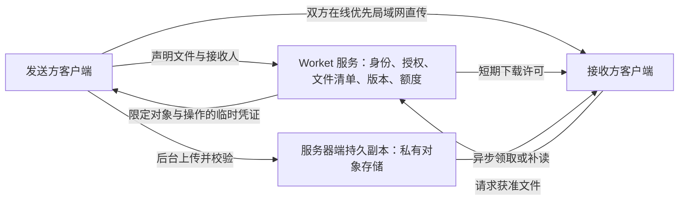

# 工作交付、组合与公共要求：结构前瞻审视

日期：2026-09-23。源码基线：`dba80bf496c152b3e1332b7012036a83d47b89a5`。分析分支：`codex/work-composition-design`。

状态：设计讨论稿，尚未批准功能实现。本文以当前源码、持久化结构和产品约定为依据；没有新增真实模型试验、跨人协作或生产验收。下文新增术语均是候选设计，正式词汇仍见 [CONTEXT.md](../../CONTEXT.md)。

## 1. 判断：底层关系可保留，当前结构不能原样满足

当前 `WorkDefinition → WorkInstance → WorkRecord` 已经分开了“一类工作、一次工作、这次工作的事实”。它适合作为未来组合与抽象的基础。缺口主要在工作之间的关系、公共要求的独立复用，以及组织身份和授权的执行机制。

用户的两个需求指向同一价值：一份工作除了能被本人继续，也能成为别人的可靠输入；多份工作中的共同约定可以成为团队资产。前者复用具体成果，后者复用要求，两者都需要保留来源和适用边界。

| 未来需要 | 当前已经有的基础 | 仍缺什么 |
| --- | --- | --- |
| 同一项工作换人继续 | 独立 workId、ExecutionEpisode、交接包；Executor 类型包含 HUMAN | 可认证的人员身份、跨人交付与访问控制；HUMAN 标签本身不提供这些能力 |
| 完成 A 后由另一人开展 B | 成果 ArtifactRef、验收事件、固定本次输入 | 持久的成果发布版本、A 的哪个成果进入 B 的哪个输入、独立责任与接收记录 |
| 结果先行，按需取过程 | MCP 主上下文、按事件或分页读取证据 | 面向接收人的可见范围、过程请求与批准、跨机器可读取的材料 |
| 多份工作组成流程 | 同一工作快照内已有阶段、成果、版本和 dependsOn | 跨 WorkInstance 的稳定依赖、并行/汇合、整体输入输出和整体验收 |
| 从同类工作提取共同要求 | 多记录沉淀、兼容性判断、出处、规则范围和版本 | 可被多个工作定义引用的公共规则集，及其采纳、升级和冲突处理 |
| 部门公共要求与权限 | 定义内可复用约束、本机 Bridge 认证、托管服务身份 | 部门/项目成员、规则发布权、资源权限与执行授权；已有服务认证不能替代组织授权 |

### 源码依据

- [核心类型](../../src/core/types.ts) 和 [数据库结构](../../src/core/schema.ts)：WorkInstance 目前有一个 definitionId，没有跨工作关系或组织身份字段；Executor 只有类型和名称。
- [ContinuationSnapshot](../../src/handoff/continuation.ts)：已经包含 stages、outcomes、acceptance 和 `dependsOn(stageId, outcomeId, version)`，作用域是一次工作的理解快照。快照内的阶段/成果 ID 尚不是独立持久、可跨人引用的业务身份。
- [定义契约](../../src/contracts/definition.ts)、[后台抽取流程](../../server/workflow.mjs)、[沉淀服务](../../src/distillation/service.ts)：先在每项工作内协调要求，再跨工作泛化；当前单次最多 5 个来源，输出一个 DefinitionContent。groups 是本次抽取的分组建议，不是长期工作集合；UNRELATED 时 content 为 null。
- [规则解析](../../src/contracts/rules.ts)：已有 REUSABLE / INSTANCE / UNCERTAIN、ACTIVE / PROPOSED / RETIRED，以及重复、补充、替代、冲突；规则关系目前只解析同一 DefinitionContent 内的地址。
- [定义与验收仓库](../../src/definitions/repository.ts)：定义版本固定，验收记录关联交付物 ID/hash；这是成果验收的基础，但没有接收人身份与跨工作采纳关系。普通“完成”也不等于有逐项验收证据。
- [工作包](../../src/definitions/work-package.ts)：固定规范、技能和实例输入已有本地版本机制，普通成果仍依赖 ArtifactRef 路径；包内明确要求本机二进制资料另行传递。
- [MCP 读取](../../src/bridge/mcp-handler.ts)、[HTTP Bridge](../../src/bridge/http-bridge.ts)：按需补读已实现。Bridge 使用本机进程令牌，MCP handler 按 work_id 取工作，没有按接收人裁剪结果/过程；delivery_id 用于关联本次读取，不是接收人授权。

## 2. 先分清四种操作

| 操作 | 例子 | 工作身份与结果 |
| --- | --- | --- |
| 接续 | 同事替我完成尚未完成的报告 | 保持同一个 WorkInstance，新增执行片段 |
| 组合 | 调研结果交给方案作者，方案再交给审核人 | 多个 WorkInstance，通过成果与输入关系连接 |
| 归集 | 将小组本月 20 份调研放在一起观察 | 形成一个集合/视图；成员之间不因此产生执行顺序 |
| 抽象 | 从多份调研中提炼共同来源要求和验收标准 | 形成候选定义或候选公共规则，确认后用于新的工作 |

是否需要新 WorkInstance，主要看目标、交付和验收能否独立成立，而不是看是否换了人、换了会话或多了一步操作。一个人也能执行多个独立工作；多人也可能接续同一个工作。

同类型工作通常先归集再抽象，并不必然组成流程。流程中的工作可以完全不同类型。“属于同一部门”“依赖某项成果”“采用同一规则”也是三种关系，单个 parentId 无法清楚表达。

## 3. 需求一：成果是连接工作的接口

以“我完成调研，同事写方案，负责人审核”为例：


A 可以保持完成状态，B 有自己的目标、执行者、记录和验收。只查看或接收 A 的结果还不需要新建工作；接收人实际开展有独立交付的任务时，再创建或绑定 B。

### 交付内容与过程分开提供

接收人默认看到：交付的具体成果版本、已核实的验收范围、重要前提和未解决事项，以及支撑这些内容的证据索引。会影响正确使用的前提不能全部藏在过程里。

接收人需要了解“这个数字怎么来的”“为什么排除某个选项”时，可按结果、要求或事件范围补读。已批准范围内直接读取；超出范围形成访问请求，由有权的人批准。过程包括可见对话、操作记录、资料版本和验收记录，不包括模型隐藏思维。

接收结果、读取过程、确认适用于 B，以及完成 B，分别记账。已有 MCP 读取回执只能证明一次读取，不能代替接收人对成果的业务认可。

### 最小关系应表达什么

| 候选表达 | 必须回答的问题 |
| --- | --- |
| 成果版本 Outcome | 属于哪个工作？具体交付什么？内容和文件 hash 是什么？由谁、按哪些标准验收？证据在哪里？ |
| 工作依赖 WorkLink | 哪个上游成果版本进入哪个下游工作的哪个输入？在什么条件下可用？谁确认了采用？ |
| 交付与访问记录 | 向谁交付了哪个版本？允许看哪些结果/过程？对方是否收到或请求更多信息？ |

Outcome 可以引用现有 ArtifactRef 和 work.acceptance，也应容纳无文件成果，例如一项已确认决定。一个成果可以进入多个下游工作，一个工作也可以消费多个上游成果。文件路径只是当前机器上的位置；跨人交付还需要可访问的内容副本或受控地址，并保持内容版本可核对。

A 后续发布 v2 时，B 已使用的 v1 保持原样。系统标记受影响的依赖，由 B 的负责人决定是否采用 v2；采用应生成输入修订与重新检查记录，不静默替换，也不自动重跑已完成工作。成果未验收时，可按明确约定允许作为草稿输入，不能假装已经通过验收。

### 工作流也可以对外表现为一份工作

调研、方案、审核组成“完成客户方案”后，整体仍可用目的、输入、交付、约束、验收来描述；内部再保留子工作和依赖图。这与当前 WorkDefinition 的外部表达兼容。

建议先支持具体实例之间的连接。当一套组合反复使用、整体交付也明确时，再把它沉淀为带 composition 的工作定义。该定义固定各步骤的定义版本、输入输出映射、开始条件和整体验收；执行时产生一个整体实例与各子实例。整体是否完成由整体交付决定，不能简单把所有子任务“完成”相加。

第一版显式依赖可保持无环，支持并行与汇合。返工通过新的成果/输入修订记录，不把历史依赖改成循环。此处只表达依赖和就绪条件，不要求 Worket 自动调度或自主执行所有步骤。

## 4. 需求二：把公共要求作为可独立引用的约定

例如，小组做了 20 份市场调研。其中反复出现“数字必须标注来源和日期”“结论区分事实与假设”；“调研日本市场”和“本次交付 PPT”则不一定通用。

先将同类实例归集，按语义、适用条件、纠正关系和反例提炼候选；然后由有权确认的人决定哪些成为团队规则。出现次数支持发现候选，不能单独证明规则应对全组生效。没有可靠共性时，可以保留实例特例或返回没有可提升的规则。

建议提供独立、版本化的公共规则集 RuleSet。“调研规范 v1”可同时被“竞品调研定义”和“市场进入分析定义”引用，后者仍保留各自输入、交付和验收。一次工作的有效约定来自这些已确定版本：

```text
适用的组织/小组公共规则版本
  + 本类 WorkDefinition 版本
  + 适用于本次的输入与已批准例外
  → 带来源、适用范围和冲突状态的本次有效约定
```

这里的 `+` 是解析适用性与冲突，不是把文字拼起来或让最后一条覆盖前面。公共规则应记录稳定身份、版本、发布者及其权限、适用条件、效力与例外规则、来源/反例和明确采用关系；并非所有公共要求都能由个人的实例覆盖解除。

建议区分必须遵守的要求、允许例外的默认要求，以及参考方法。实例特例只能在被允许的范围内调整默认值；不同来源的硬性要求冲突时先解决冲突。现有 effectiveRules 可复用内部解析经验，但跨规则集地址、发布权和例外权还需要补充。

抽取的一般化与组织采纳是两个步骤：普通成员可以提出候选，有规则发布权的人决定是否成为公共约定。个人确认一个定义，不能自动代表整个部门确认。

### 两个容易漏掉的扩展

**共同要求可能横跨不同工作类型。** 调研与方案无法合并成同一种工作，仍可能共同遵守“对外结论须标来源”。当前 UNRELATED → content null 对生成单个定义合理，未来抽取公共规则需要独立目标，不能先强迫不同工作兼容为一个定义。

**公共规则升级需要显式采用。** 新实例解析适用版本并冻结有效约定与来源映射；进行中的实例显示差异并决定是否采用，历史记录保持可追溯。来源撤回后标记依据变化，已发布规则是否撤销由有权的人决定。权限的实时撤销则另行生效，不能因为工作约定已固定而失效。

部门适合作为规则与资源的治理范围。部门里可以有多个工作集合、工作定义和流程；同一工作也可以同时属于项目视图和部门视图。它们无需被压成一棵单继承的工作树。

## 5. 公共要求与公共权限需要不同的生效依据

| 表达 | 例子 | 如何生效 |
| --- | --- | --- |
| 工作要求 | 调研报告必须标注数据日期 | 由适用的工作约定与验收确定 |
| 能力/权限需求 | 开展此类工作需要读取项目资料 | 可从记录提出候选，进入定义；本身不授予访问权 |
| 实际授权 Grant | 成员乙可为工作 B 读取客户甲的指定文件，到月底有效 | 由有权主体按资源、操作、工作、期限签发并执行 |
| 部门公共策略 | 小组成员可读取公共规范；客户原始数据仍按项目授权 | 由组织身份和策略确定适用成员，不取各工作历史权限的并集 |

因此，可以抽象共同的“权限需求”，也可以由管理员建立公共授权策略；不能因为多个员工曾访问不同客户资料，就让全组获得这些资料。成果可见也不意味着原始过程全部可见。

实际访问建议同时满足：可认证的调用者身份、有效的委托关系、匹配本次工作/资源/操作的授权，以及当前组织与执行环境限制；每次受控授权判断都检查过期、撤销和明确拒绝。文件直传使用已签发链接时还需明确撤销时效，见第 10 节。更换执行者时核验新的身份与委托，不能仅复制旧 token。下载后的副本无法靠撤销远程访问自动收回，这应成为真实交付语义的一部分。

组织可以预先批准共享范围，在范围内自动处理正常访问，无需每次补读都打扰交付者。超范围请求才升级处理。读取主包、搜索、证据分页、文件下载和导出都必须遵守同一可见范围；只在界面隐藏过程没有形成授权边界。

执行操作的权限还需由实际资源服务或工具入口执行。写进工作包的权限文字，无法限制已经持有独立外部凭据的执行者；未来应明确哪些操作真正受控。子工作也只能获得委托范围内的授权，不因属于同一个流程而自动拥有全部上游权限。

脱敏或概括后的结果同样需要判断可共享范围，不能仅因为它是“摘要”就公开。验收时应同时检查正文、引用摘录、文件名和元数据，避免从索引绕过过程限制。

## 6. 对当前结构的最小演进建议

保留现有工作身份、定义版本、来源档案、执行片段及本次输入机制，逐步增加下面几种明确关系：

| 位置 | 建议增加的表达 | 可复用的当前基础 |
| --- | --- | --- |
| 单个工作对外的交付 | 稳定成果身份、发布版本、验收/限制与过程索引 | ArtifactRef、work.acceptance、Continuation outcome、材料固定 |
| 多工作连接 | 上游成果版本 → 下游输入，并记录采用/修订 | WorkInstance、instance inputs、输入修订 |
| 可复用组合 | definition 的可选 composition：子定义版本、连线、整体输入输出和验收 | WorkDefinition 与固定版本；实例关系成立后再加入 |
| 公共要求 | 独立 RuleSet 及 definition 的规则版本引用；本次有效约定快照 | DefinedItem、Basis、RulePolicy、候选审阅 |
| 组织协作 | 人员/组/项目范围、规则发布权、资源策略与实例授权 | 当前安装/服务身份只能作为接入基础，仍需建立组织身份映射 |

不建议把所有信息塞入八字段 WorkState：它是当前工作投影，难以承担独立成果、规则版本和授权事实的生命周期。ContinuationSnapshot 适合表达“模型如何理解当前工作”，正式工作连接和组织规则还需用户操作或可信业务事件确认。

抽取输出应保留已有出处与推断区分，并针对新目标产出可审阅候选：成果及其限制、跨工作依赖、公共规则的适用范围与反例、所需能力。模型可以建议这些关系；程序负责稳定身份、版本、引用与权限验证，有权的人负责发布和采用。

实现时可将复杂性集中在三个 Module：WorkComposition 负责成果连接与影响追踪，ContractResolver 负责规则版本解析及冲突，WorkAccess 负责可信身份与每次访问判断。它们提供结果/依赖、有效约定、授权决定等小 Interface，工作包组装和不同传输 Adapter 共同消费。现阶段不要求新增通用图数据库或改写全部核心模块。

备选方案比较：单加 parentId 上手快，但会混合集合、流程和组织，无法自然表达一对多成果消费；直接把 Continuation stages 扩成全部工作，则会让模型可重算的快照承担稳定身份与授权。显式成果连接和独立规则引用更贴合现有核心结构。

## 7. 建议的验证顺序

| 阶段 | 一次完整的交付目标 | 主要证明点 |
| --- | --- | --- |
| 1. 两个人、两份工作 | A 完成一份调研；同事在另一机器收到固定成果，绑定为 B 的输入，按需读获准过程并完成方案 | 成果实际可用、身份与可见范围有效、A/B 独立、来源可追溯 |
| 2. 同类实例抽象 | 选择一小组真实同类工作，提出并确认公共规则，用在未参与抽取的新工作 | 共性与特例分开，没有旧客户/旧结论污染，确认规则确实适用 |
| 3. 多定义与部门采用 | 两种工作定义引用同一公共规则，小组负责人发布新版本；配置一项真实公共资源策略 | 规则版本与冲突明确、发布权有效、资源访问不随归集扩大 |
| 4. 可复用整体流程 | 将已验证的 A→B→C 沉淀为组合定义，用新输入运行 | 子定义版本、输入输出映射、整体验收和影响追踪成立 |

第一阶段即需要最小真实身份与结果/过程授权，不把这些留到“部门功能”最后补。各阶段是否自动推进由未来产品决策确定；本轮只提出设计与验收依据。

## 8. 评审用反例

| 场景 | 预期行为 |
| --- | --- |
| 甲完成 A，乙只是下载结果 | 不为了下载创建空工作；不重新打开 A |
| A 的同一个 v1 同时进入 B 和 C | 保留一个源成果版本、两条独立采用关系，不共享 B/C 的生命周期 |
| B 等待 A1、A2；A1 仅自报完成 | 按已约定的输入条件判断是否就绪，自报不冒充验收 |
| A 更新 v2，B 已完成 | B 保留 v1 与原验收，显示影响；采用更新后留下修订，不抹去历史 |
| 乙可看结果但不可看原始客户对话 | 主包可用；补读、旧 archive 接口、索引与导出都不能绕过权限 |
| 相同交付重试，或过程请求待批准 | 不重复创建 B；明确区分已交付、已读取、待授权与来源不可用 |
| 二十份成功工作中两份有临时豁免 | 豁免保持条件与来源，不被多数投票抹去，也不自动升级为共同权限 |
| 两种工作无法合并为一个定义，但共享来源规范 | 可以提出公共规则候选，各工作定义保留自身语义 |
| 部门要求标注来源，本次要求省略来源 | 若属不可豁免要求则阻止该覆盖；有例外权时保留具体批准依据 |
| 同一工作属于项目 A 与部门 B | 同时校验适用规则并暴露冲突；不靠任意父级顺序决定 |
| 定义固定了公共规则 v1，执行者权限随后被撤销 | 历史约定仍可审计，停止签发新访问许可；已签发文件链接按明确的撤销时效处理 |
| 原始过程被删除或离线，成果已有接收副本 | 标明过程不可得及保留范围，不伪造解释，也不声称收回已交付内容 |

## 9. 产品重点：让接收方能够依据成果开展下一份工作

本轮追问中，用户提出身份系统、先加好友、渐进式披露过程作为初步重点。下面是助手对优先级的建议，好友是否为必经步骤尚未确定，不代表已批准实现。

核心体验目标：接收方能够知道拿到了什么、适合用来做什么、哪些地方还不能确定，并在需要时获得有出处的解释。身份与披露机制服务于这个目标。

| 重点 | 用户实际要完成的事 | 建议优先级 |
| --- | --- | --- |
| 身份、联系人与工作权限 | 知道交给谁、谁负责解释、对方可读什么 | 第一版：可信身份与定向邀请；联系人便于复用关系，团队身份后续接入 |
| 明确的交付约定 | 收到成果、关键前提、未决事项、验收范围，能判断是否适合下一步 | 第一版：成果可在接收端实际打开与使用，保留固定版本 |
| 渐进式披露与定向补读 | 围绕具体疑点查依据，减少无关上下文 | 第一版：相关证据可定位、权限可判断；超出范围可向负责人请求 |
| 接收、采用与责任衔接 | 接收人确认把哪个成果用于哪份工作，并能反馈不适用或需要补充 | 第一版：区分已送达、已采用、待补充；沿用原有业务验收，不把打开当成验收 |
| 版本与影响追踪 | 上游修正结果后，下游知道是否需要调整 | 第一版：保留已采用版本、提示变化；复杂多级影响后续增加 |
| 公共要求的抽象与采纳 | 将反复适用的要求用于下一份工作，保留条件与例外 | 协作链成立后：小范围候选、负责人确认、版本引用与新实例验证 |

### 身份不必绑定一种社交入口

“我是乙”“甲把乙存为联系人”“乙可读甲的工作 A”分别是身份、关系和具体权限。好友可以降低重复寻找接收人的成本，仍需按工作确定共享范围。建议同时支持定向工作邀请；将来组织成员关系也可以作为协作入口。对一次性协作是否强制双方先建立好友关系，应根据实际摩擦验证。

### 渐进式披露要能定位问题对应的证据

建议顺序为：成果与关键前提 → 支撑某项结论的依据 → 相关资料片段/可见过程。接收方本人或其执行者提出“这个数字的口径是什么”时，只补读获准且相关的原始片段，并显示它对应哪个成果版本。若证据不足，再向交付负责人请求补充；不能编造来源，或把继续展开当作获得更多权限。

关键前提、已知限制和未解决事项必须随成果首屏交付；按需读取的是详细依据。索引也需按可见范围生成。用户已明确要求服务器保存交付副本：共享范围内的成果、资料与过程在云端保存完成后，可在交付者离线时继续读取；未上传完成、被删除或没有权限要区分表达。双方在线时优先局域网传输，具体机制见第 11 节。

### 工作流可以由实际采用关系逐步形成

接收人选择“用这份成果开展工作”，指定目标或绑定已有工作后，系统记录上游成果版本到下游输入的关系。同一成果可被多人采用，关系跟随实际使用建立；交付者不必在第一次分享前画出整个流程。

来源链只证明哪里来的，不能证明内容正确；成果采用也不等于认可原工作所有结论。退回补充、追加解释和后续修订应保留在具体交付关系中。公共规则的抽象则在一段真实协作积累后进行，有权的人决定其适用范围，不能根据历史出现频率自动扩大权限。

建议的首个完整体验为：定向交付 → 接收并用于下一份工作 → 围绕疑点补读或请求补充 → 收到上游修订提示。衡量是否成功时，比较首次正确开展工作的耗时、人工解释次数、补读资料量和返工，同时检查错误采用或遗漏关键限制；不能仅以发送量、好友数或查看次数衡量。

## 10. 文件传输与服务器职责

用户明确要求异步交付：服务器也要保存一份，双方在线时实时传输优先走局域网。每份交付范围内的成果、参考资料与共享过程均需形成服务器端持久副本，局域网直传成功不取消上传。服务器职责、用户存储额度和产品保留期限应一并设计；该要求不等于上传未选择的整个工作库。

当前源码核对：[managed.mjs](../../server/managed.mjs) 装配身份、管理、模型和改进样本服务；[service.mjs](../../server/service.mjs) 的模型输入是有大小上限的 JSON，请求体先读入内存，结果短期保存在内存；[默认限额](../../src/contracts/definition.ts) 为模型请求 2 MiB、结果保留 10 分钟。它没有通用工作文件上传/下载通道。[MaterialStore](../../src/definitions/storage.ts) 固定的是本机文件副本。[改进样本协议](../../src/contracts/improvement.ts) 的产品改进用途与 90 天期限也不能直接套用到同事间成果托管。本轮未登录服务器检查磁盘、带宽或负载，不据此判断当前机器容量足够或不足。

### 建议分工

云端持久保存与局域网即时接收是两条并行路径。服务器端副本可以保存在由 Worket 后台管理的私有对象存储中，具体存储选型仍待确定。



Worket 服务管理谁可以给谁共享哪些文件、成果与文件版本的关系、传输状态、额度与保留规则。文件字节可以由客户端直接传入/读出私有对象存储，避免所有大文件占用现有应用服务的带宽、内存与磁盘。身份与文件管理接口仍需开发；仅开通存储桶不等于功能完成。

已核实的外部能力（2026-09-23）：腾讯云 COS 支持有效期受控的预签名上传和下载，可作为该分工的一个候选实现，见 [官方说明](https://cloud.tencent.com/document/product/436/68284)。大文件可用分块上传降低中断后的重传量，见 [分块上传](https://intl.cloud.tencent.com/zh/document/product/436/14112)；断点恢复与凭证续期仍需要客户端/服务协同处理。尚未选择具体地域、开通资源或配置凭据。

### 渐进式披露需要对应的可用性承诺

发送方关机后，接收人可以使用本机已收到的副本，或从服务器领取已完成保存的共享内容。渐进式披露控制读取量，共享清单中的资料即使尚未被接收人展开，也应完成云端保存。清单之外的本地资料仍需申请补充，并在纳入新的共享范围后上传。

第一版交付时固定成果、共享资料与过程快照，建立持久上传任务，同时尝试局域网直传。接收方可先使用已完整校验的局域网副本；只有服务器确认清单内内容全部保存完整后，才能宣称该交付可异步领取。共享过程的授权、模型分析授权及参与产品改进的授权分别处理；用于协作的文件不自动成为模型输入或改进样本。

### 首版需要落实的要求

| 要求 | 具体约束 |
| --- | --- |
| 完整性与交付状态 | 文件清单记录逻辑路径、大小、hash、成果版本与共享范围；接收方完整校验后可本机使用，服务器完整保存并校验后才可异步领取。多文件成果保留必要相对路径，传一个本机路径不算交付 |
| 中断与重复 | 传输可重试，大文件支持适合其规模的续传；失败不产生假成功，取消后清理未完成上传，重复请求不重复记交付 |
| 访问范围 | 私有对象按具体文件/版本/操作授权，持有工作 ID 或文件 hash 不等于有下载权；补读片段及预览使用相同范围 |
| 撤销时效 | 停止签发新许可不必然使既有签名 URL 立即失效；首版需要选择并公布短链接有效窗口，若要求每次下载实时撤销则需可重验权限的访问路径。已下载副本不能远程收回 |
| 存储生命周期 | 定义单文件/每份交付/每用户额度与保留期；到期、删除、下游已采用版本及备份恢复一起考虑，不能静默清掉仍承诺可用的依据 |
| 运行与成本 | 记录上传失败率、可获取率、存储量和下载量；确定用量限制与告警。恢复需要验证文件内容及其元数据、版本与授权关系一致 |

成本应分开估算存储容量、下载流量和请求次数，预览/解析、备份与多版本另计。腾讯云的计费也分列这些项目，见 [计费说明](https://cloud.tencent.com/document/product/436/30747)。没有测量文件大小、分享频率、保留期和下载次数前，不给出月费或扩容承诺。容量粗估可从“每天新增共享字节 × 保留天数 × 版本/副本影响”开始，流量则单独按实际下载及重试估算。

云端路径验收应包括：发送方上传后离线，接收方仍能获取固定成果和获准证据；未授权文件不可读；中断可恢复；hash 不匹配不能就绪；新成果不覆盖旧采用版本；到期/删除与访问撤销按已声明规则生效。局域网路径见下节。当前 VPS 可作为拟议的业务接口部署位置，是否需要扩容须另做容量与负载核验；本轮不变更服务器配置。

## 11. 异步交付：服务器持久保存，实时接收优先局域网

用户确定的行为是“服务器也要存，但是实时的传输优先走局域网”。因此，服务器副本是交付能力的组成部分，局域网负责加快双方在线时的接收，并减少对应的云端下行流量。同事实际直连比例与节省量尚未测量。功能实现尚未开始。

### 用户体验与路径选择

用户选择接收人和交付范围后，客户端冻结同一份成果版本和共享清单，分别启动后台上传与接收端交付。接收端已有校验通过的副本时直接复用，否则优先尝试获准设备间的加密局域网连接；直连失败或接收人稍后上线时，从已保存的服务器副本领取。若服务器尚未保存完整，明确等待上传，不提供假就绪的下载入口。

| 情况 | 数据从哪里来 | 主要边界 |
| --- | --- | --- |
| 接收方已有完整固定副本 | 本机缓存 | 校验版本与完整性；新版本另行采用 |
| 双方在线、局域网可直连 | 发送方 → 接收方，同时发送方 → 服务器 | 接收方可先使用完整副本，后台上传继续 |
| 直连失败或接收方稍后领取 | 服务器 → 接收方 | 对应云端内容须已完整保存并校验 |
| 发送方离线、云端已经保存 | 服务器 → 接收方 | 仍按交付版本、共享范围与保留期读取 |
| 发送方离线、云端尚未保存完整 | 已完成的本机副本，或等待上传恢复 | 本机已收到与可异步领取分别表达 |

后台上传不等待对方上线，也不因局域网接收成功而停止。直传与上传必须读取同一固定副本，避免传输期间原文件变化导致两边版本不同。首次可由发送方负责云端上传，不把接收方自动变成代传服务。发送方本机保留上传队列和固定材料，断网、退出或重启后可恢复未完成的上传；这些恢复能力需要实际开发与验证。

### 两个独立的完成条件

| 状态维度 | 表达什么 | 达成依据 |
| --- | --- | --- |
| 接收方已收到 | 这个接收人已有可用的固定副本 | 接收端按交付清单完成文件/过程完整性校验并确认 |
| 服务器已保存，可异步领取 | 其他获准接收端无需原发送方在线即可获取 | 服务端确认所需内容持久保存完整并校验清单、版本、大小与内容完整性 |

两者可以任意先完成。界面可表达“同事已收到，云端上传中”，也可表达“云端已保存，等待同事领取”；不合并成一个含义不清的完成标记。网络传输完成与业务采用/验收仍然分开。云端失败时保留真实的接收回执和待上传状态，重试不重复创建交付；服务器确认保存前，不能把唯一待上传的固定副本按交付成功清掉。

### 能减少哪些服务器负担

服务器仍需保存每份交付的固定副本，并承担对应上传、存储与保留成本。局域网直传主要减少原本从服务器向接收人发送的下行字节，并可能降低等待时间；它不消除上传和存储需求。网络中继也需要搬运文件字节，不能把中继连接计为无服务器流量的直连。

后续测量接收字节中经局域网传输的比例、云端下行减少量、交付等待与后台上传完成率，同时记录实际存储量。直传与上传并行会共享发送端资源，调度与限速须避免一条路径长期挤占另一条。此轮不承诺具体加速或节费比例。

### 最小技术边界

当前 [本机 Bridge](../../src/bridge/http-bridge.ts) 只监听 127.0.0.1，持有用于本机 MCP/Hook 的进程令牌；没有已实现的局域网文件服务。新增传输端点应只读取固定交付清单内的资源、校验接收设备与本次授权、加密传输，并支持校验和重试。不得直接把这个 Bridge 改为面向局域网监听，也不向对方提供本机路径访问、MCP/Hook 权限或整个工作库。

发现设备可以使用局域网服务发现，也可以让既有身份服务协助交换候选地址；发现后仍需认证并检查实际连通性。同一办公室或 Wi-Fi 不保证互通，客户端隔离、不同网段、VPN 和防火墙都应纳入验收。只对获准接收设备尝试连接，发现广播不包含工作名称、文件清单或正文。

外部能力核实（2026-09-23）：[Apple Bonjour](https://developer.apple.com/bonjour/) 支持局域网设备与服务发现；[RFC 6762](https://www.rfc-editor.org/info/rfc6762/) 描述 mDNS 的本地链路发现范围；[RFC 8445](https://datatracker.ietf.org/doc/html/rfc8445) 区分候选地址、连通性检查和中继路径。它们证明相关机制存在，不证明 Worket 已接入、企业网络普遍可达或一定无需服务器流量。具体采用局域网专用传输还是 WebRTC 等方案，应在实现前按打包应用的连通性、复杂度和安全接口做选型。macOS 系统本地网络授权与应用防火墙同样要通过真实安装包验证。

首版沿用在线身份与交付协调，并在后台完成服务器端保存；局域网加速不代表应用全部功能支持断网。完全离线或企业全内网部署还需要本地身份、授权更新与撤销、元数据同步等独立安排，本轮不引入这些范围。

验收至少覆盖：两台真实同网设备收到同一固定版本，云端同时完成保存；确认接收文件字节走局域网而非服务器下行；接收人离线时发送方独立完成上传，随后发送方关机，接收人仍可领取；局域网先完成、云端先完成和其中一路失败均正确表达；断网/退出后上传队列恢复；直连失败转云端不重复接收且版本一致；未授权文件始终不可读；超范围资料不因上传或路径切换而新增共享。补读过程遵守相同授权、版本与云端保存规则。此轮没有启用监听、扫描用户局域网或实现传输功能。

本轮交付为上述结构判断、候选演进与评审案例。已核对引用源码与本地链接；这些案例尚未作为新功能运行验收，不能据此宣传已支持工作流或部门协作。
