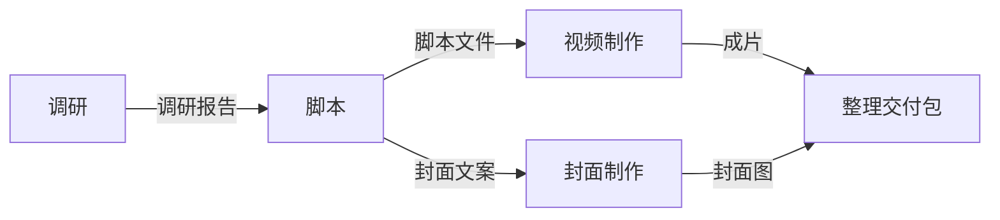

# Work Contract 工作流组合方案 v1

初稿日期：2026-10-20；实现日期：2026-10-21。状态：**用户已授权按原型实现，首版已接入工作流组合、独立运行与验收返工闭环**。本文保留设计取舍；实际接口与已验证范围见第 12 节和验收记录。

## 1. 目标与核心取舍

让用户把已经确认的不同 Contract 连接成可复用流程；每次用新输入开展流程，都拥有独立进度、工作实例、成果和验收记录。单项工作仍可独立运行，也可被多套流程复用。

建议在现有 WorkDefinition / WorkInstance 之上增加组合层：流程定义管理连接关系，流程运行管理本次执行。节点业务内容继续使用既有 WorkInstance 与 WorkRecord，不另建一套任务系统。流程本身也有明确输入与最终输出；其输入输出沿用 Contract 的类型语义，为以后组合子流程留出接口，但首版不加入嵌套运行。

首版支持固定节点的顺序、并行和汇合；先由用户验收上游成果，再准备下游工作。条件分支、动态批量展开、循环、嵌套流程和无人值守执行，留到有实际案例时设计。

## 2. 对象关系

| 对象 | 保存什么 | 不承担什么 |
| --- | --- | --- |
| WorkDefinition / Contract | 单项工作的输入、输出、规则、资料与固定版本 | 不保存某个客户的执行进度 |
| WorkflowDefinition / 流程定义 | 名称、版本、流程输入、节点、输入绑定、最终输出映射 | 不保存运行状态或当前成果 |
| WorkflowRun / 一次流程运行 | 流程固定版本、本次输入、运行身份、各节点运行记录与操作历史 | 不复制节点的业务记录与原始对话 |
| NodeRun / 节点运行记录 | 所属流程运行、节点 ID、执行代次、关联 WorkInstance、调度状态、实际采用的输入与输出版本 | 不代替 WorkInstance、WorkRecord 或 ExecutionEpisode |
| OutputVersion / 成果版本 | 输出键、固定值或文件快照、来源工作、生成代次、校验与用户验收依据 | 不用会变化的原路径充当稳定成果 |

一个流程定义对应多次运行。每次运行的每个节点有自己的节点运行记录；输入未齐时允许还没有 WorkInstance，准备开展时才创建。一次正常节点运行关联一个 WorkInstance。交付重试或更换执行者沿用该 WorkInstance；明确重做节点则创建新的执行代次与 WorkInstance，历史保留。

同一 Contract 可在多个流程、甚至同一流程的多个节点使用。节点以稳定 nodeId 区分，不能以 Contract ID 充当节点 ID。执行者是节点的默认选择与本次运行的可调整配置；更换执行者不改变工作身份。

## 3. 如何连接 Contract

连接表示一项明确的数据采用约定：**上游指定输出，进入下游指定输入**。连线是输入绑定的可视化投影，不独立再维护一份数据依赖表。

例如一套内容制作流程：



脚本完成并验收后，视频和封面可独立推进；交付包等待成片与封面都准备好并验收。

### 3.1 输入输出端口

当前 InputSpec 已有稳定 key、valueType、required、choices 和 defaultValue。建议为 deliverables 增加可连接输出的类型描述，并保留现有文字约定与来源依据，例如 `reportFile: FILE`、`coverCopy: TEXT`。文件端口可声明格式要求。类型描述需要纳入确认后的 Contract 新版本，不回写旧已发布版本。

旧 Contract 可继续独立使用；加入自动连接前，用户确认它的输出口。AI 可以建议名称与匹配关系，连接采用须显式确认。相同文件类型只证明结构兼容，业务含义仍须符合输入约定；需要摘要、转格式或合并时，用明确的一项工作承接，不能让连线悄悄改写内容。

### 3.2 每个输入的来源

| 目标输入 | 来源类型 | 示例 |
| --- | --- | --- |
| 调研.topic | 本次流程输入 | run.inputs.topic |
| 调研.language | 流程固定值 | 中文 |
| 脚本.research | 上游节点输出 | 调研.reportFile |
| 视频.script | 上游节点输出 | 脚本.scriptFile |
| 封面.copy | 上游节点输出 | 脚本.coverCopy |
| 交付包.video / cover | 两个不同输入，各自绑定 | 视频.videoFile / 封面.imageFile |

同一输入只有一个明确来源，未绑定时可使用 Contract 已声明的默认值；必填项不能悬空。一个输出可以供多个下游使用。多份成果不得隐式拼成一个输入，应分成不同输入口或经过显式合并节点。仅表达先后顺序、没有数据传递的需求可使用前置节点列表，并与数据依赖共同检查无环。

流程最终输出映射到选定的节点输出，例如 `deliveryPackage ← 交付包.packageFile`。首版全部节点均为必需，全部完成且最终输出有效才完成整套流程。

## 4. 流程定义与运行结构

以下为方案的逻辑字段；实际接口以 `src/workflows/types.ts` 为准：

```text
WorkflowDefinition（固定版本）
  id / definitionKey / version / name
  inputs                         整套流程需要用户提供什么
  nodes[]
    nodeId / name
    contractVersionId            固定的 Contract 版本
    inputBindings                流程输入、固定值或上游输出
    after[]                      可选，仅控制顺序的前置节点
    defaultExecutor              可选，默认交给谁
  outputs                        最终交付对应哪些节点输出

WorkflowRun（一次执行）
  runId / workflowVersionId / name
  inputs                         本次值、文件快照及来源
  status                         RUNNING / PAUSED / COMPLETED / CANCELLED
  nodeRuns[]
    nodeId / generation / workId
    phase                        等待输入、可开展、等待接手、执行中、待验收、已通过、失败、已取消
    adoptedInputs[]              实际采用的上游工作、输出键、成果版本与快照
    outputVersions[]             本代次交付、校验与验收依据
    executorSelection            本次执行者选择
  events[]                       创建、准备、采用、交付、验收、重做等流程操作事实
```

节点运行记录只拥有调度事实；执行进度和业务证据从既有 WorkInstance / WorkRecord 投影。待处理、受阻等流程提示从节点事实计算，避免另存一套会与节点矛盾的总体进度。

## 5. 整套流程多实例运行

用户保存“内容制作流程 v1”后，点击“开展一次”，提供本次客户、主题、材料和执行者选择，创建一个 WorkflowRun；再开展一次，创建另一个 WorkflowRun。

| 内容 | 客户甲这次运行 | 客户乙这次运行 |
| --- | --- | --- |
| 共用内容 | 内容制作流程 v1 及其固定 Contract 版本 | 相同定义 |
| 输入 | 甲的主题与材料快照 | 乙的主题与材料快照 |
| 节点工作 | 甲的调研、脚本、视频等独立工作 ID | 乙的独立工作 ID |
| 状态 | 例如脚本待验收 | 例如调研执行中 |
| 文件位置 | 甲的运行目录与各节点代次目录 | 乙的独立目录 |
| 暂停、失败与重做 | 只作用于甲这次运行 | 独立推进 |

隔离不只依赖数据库 ID。每次运行有独立工作目录，节点的每个执行代次有独立输出目录，输入和已发布成果固定快照，固定资料可只读共享。外部执行者须使用对应目录和独立会话；共享同一可写仓库又无法提供隔离环境的节点应排队，不能仅因工作 ID 不同就宣称安全并行。

所有内部成果绑定必须属于同一 runId。确需使用其他运行的成果时，用户显式将其作为外部输入导入并固定版本，不自动跨运行寻找“最新成果”。

## 6. 执行、验收与继续

1. 创建运行时固定流程版本及其所有 Contract 版本，核对图无环、输入绑定完整、类型兼容、资料可用与规则无冲突。流程参数通过显式输入传递，不隐式覆盖节点 Contract 的约束。
2. 上游尚未验收的节点等待输入；全部依赖满足后节点变为可开展。用户点击开展时核对并固定输入、准备独立目录，幂等创建对应 WorkInstance。
3. 沿用现有交付和接手证据。打开目标应用、填入草稿、会话绑定和工作包读取分别记账；打开应用不代表开始执行。首版在节点输入就绪后提示用户开展，外部应用需要用户发送的步骤继续由用户完成。
4. 执行者提交成果后，关联具体输出键、固定成果版本并完成文件或值校验。文件存在或执行者自述完成只能进入待验收。
5. 用户按 Contract 验收后，发布可供下游采用的成果版本。下游据此准备输入；首版以整项节点验收为放行单位，不投机消费部分未验收成果。
6. 可并行节点各自受执行者和工作目录的并发限制；容量不足时排队。调度动作按 runId、nodeId、generation 和操作 ID 去重，重启后恢复持久记录，不重复创建已准备的工作。

首版的自动化是依赖判断、输入准备、状态汇总和恢复，节点交付保留显式开展动作。后续若增加自动交付，须按执行端能力与用户选定的策略设计，不能把打开草稿当作无人值守执行。

## 7. 修订、重做与异常

| 情形 | 建议行为 |
| --- | --- |
| Contract 或流程定义发布新版 | 只供新运行选择，旧运行保留原固定版本；首版不做运行中结构升级 |
| 交付失败、重复点击或打开目标失败 | 重试同一次交付与 WorkInstance，不创建重复业务工作 |
| 用户明确重做一个节点 | 创建新执行代次和新的 WorkInstance；旧工作、输入、成果与验收记录保留 |
| 上游出现新成果 | 已开始的下游继续使用已采用快照；提示有新版，不静默替换 |
| 用户选择采用新版并重做后续 | 展示受影响的后续节点，确认后为受影响节点创建新代次；无关分支保留 |
| 新代次与旧代次并存 | 所有采用关系指向具体代次和版本；旧执行的迟到回流只入旧记录，不能放行新链路或覆盖新成果 |
| 用户未选择采用新版 | 原成果链可继续使用；视图必须显示实际采用版本，不能把旧下游标成已使用新上游 |
| 一个节点失败 | 保留失败现场；依赖它的节点等待，其他独立分支可以继续 |
| 文件丢失或内容变化 | 使用前重新核对，无法取得固定快照时阻止开展；不退回读取任意同名文件 |
| 暂停或取消整套运行 | 停止新的节点交付与自动放行；已在外部应用执行的工作单独显示其真实状态，不假定已被终止 |

成果版本须包含实际内容快照；现有 ArtifactRef 是发现与追溯入口，不独自承担不可变成果存储。下游采用时记录实际版本，即使共享底层只读文件，也必须保持独立归属和生命周期。

## 8. 首版使用路径

用户从“新建流程”选入已有 Contract → 为节点命名并指定输出到输入的连接 → 明确整套输入和最终交付 → 检查并确认保存流程版本。创建过程展示缺少的必填输入、输出类型和冲突，确认前不自动启动工作。

流程详情默认看到结构与“开展一次”；运行列表显示可辨认名称、日期、当前节点和待处理事项。进入一次运行后，在相同结构上查看每个节点的状态，打开节点继续使用既有工作详情与验收。常用动作是“开展”“验收并继续”“暂停”“重做这一步”；重做时说明会影响哪些下游。

完整方案可以用节点卡片与输入来源选择完成，图只是连接关系的另一种视图；首版无需把自由拖线画布作为实现前提。

## 9. 与现有代码的职责关系

建议新增一个 WorkflowCore module，集中拥有流程版本、图校验、输入采用、节点准备、幂等与恢复。它通过既有 Work Core 创建和读取节点工作，通过既有交付入口交给执行者；执行者 Adapter 不承担流程规则。

输出类型属于 Contract；不可变成果快照与输出绑定属于成果管理；流程连接与运行属于组合层。WorkRecord 保留节点业务事实，WorkflowRun 的事件只记录组合动作。一个节点独立运行时无需知道自己以后会被哪套流程使用。

现有依据：[定义结构](../../src/contracts/definition.ts)、[实例创建与验收](../../src/definitions/repository.ts)、[工作对象](../../src/core/types.ts)、[实例文件](../../src/definitions/instance-files.ts)、[交付与接手](../../src/app/app-service.ts)。本方案不把当前单工作接续快照的阶段依赖当成跨实例工作流。

## 10. 实现后必须回答的验收问题

- 同一流程同时开展客户甲、乙两次，是否创建不同工作、输入快照、目录、会话绑定与成果，且一方暂停或失败不影响另一方？
- 上游未验收或输入不完整时，下游是否保持等待；验收后是否准确采用指定输出的固定版本？
- 视频与封面是否能在独立环境并行，交付包是否等待两者，实际容量不足时是否排队？
- 重复开展、交付重试与应用重启后，是否保持同一节点代次只准备一份工作？
- 发布 Contract 新版、上游重做、旧代次迟到回复时，已采用内容是否保持稳定，新代次是否只消费新链路明确选定的成果？
- 用户选择重做后续时，是否仅重做受影响节点，原版仍可追溯，外部仍在执行的旧工作是否被如实显示？

这些是实现的验收目标；下列 2026-10-20 原型验证仅覆盖预设交互。2026-10-21 的领域与桌面验证见第 12 节，真实外部 Agent 并发业务仍待实际使用验证。

## 11. Figma 交互原型与本轮验证

2026-10-20 已验证 Codex 的 Figma 账号连接与文件读写，原型使用原生可编辑图层、组件实例和 Figma 导航交互，保存在当前账号的 Drafts。

- [连接 Contract](https://www.figma.com/proto/Hmlrx1JqYQtlH1YJh5fsML/Worket?node-id=6-257&starting-point-node-id=6%3A257&scaling=contain)：为视频制作选择脚本文件来源，查看 TEXT 与 FILE 不匹配的提示，保存连接与流程。
- [整套流程多实例运行](https://www.figma.com/proto/Hmlrx1JqYQtlH1YJh5fsML/Worket?node-id=13-531&starting-point-node-id=13%3A531&scaling=contain)：查看山海咖啡、木野户外的独立进度，再用预填资料开展鹿屿书店这次运行。
- [验收与返工](https://www.figma.com/proto/Hmlrx1JqYQtlH1YJh5fsML/Worket?node-id=13-596&starting-point-node-id=13%3A596&scaling=contain)：验收缺项提示、退回修改、修订稿 v2 复验、视频与封面并行开展，以及实际采用版本记录。
- [可编辑设计文件](https://www.figma.com/design/Hmlrx1JqYQtlH1YJh5fsML/Worket?node-id=6-257)。

已在浏览器实际点击验证：输出类型检查与保存；创建并开展第三次运行；山海脚本退回后模拟提交 v2、逐项复验并开展后续；木野仍使用原脚本 v1，明确选择 v2 后列出视频、封面、交付包的重做范围，确认后仅重置这三步；返回列表后山海仍在执行视频与封面、木野后续可开展、鹿屿仍在执行调研。另逐一检查了 2,206 个原型导航目标，无缺失节点或目标不一致。

边界：当前 Starter 套餐不支持条件与变量赋值交互，因此使用预设画面状态和导航表达分支，三个示例运行可交叉切换并保留本轮演示进度。表单为预填示例，修订稿提交为定时模拟；不支持任意新增运行、真实文件上传、实际执行者调度、持久化存储或任意次数的版本递增。重新开始体验会恢复初始状态。原型制作当日没有修改客户端、领域模型或后台；第 12 节另记录后续获授权的实现，不以原型演示替代产品验收。


## 12. 2026-10-21 首版实现

用户授权按原型实现完整闭环。已接入固定 Contract 版本与 typed 输出确认、流程图/绑定编辑和校验、独立 WorkflowRun、节点工作与独立目录、成果固定、用户逐项验收、退回新代次、采用新版影响确认、后续局部重做和重启恢复。运行/节点/输出事实以 `src/workflows/types.ts` 为准，单项工作的业务身份继续使用 WorkInstance。

执行交付沿用已有接手证据与手动发送边界；输出可在页面关联，也可经本机 Worket MCP 提交，MCP 无权批准验收。尚无无人值守执行、自动容量队列、动态条件/循环、嵌套流程、跨设备同步与 OS 沙箱。文件快照沿用 50 MiB 上限。细节见 [领域词汇](../../CONTEXT.md)、[产品](../product.md)、[架构](../architecture.md) 与 [实现验收](../acceptance/workflows-2026-10-21.md)。
